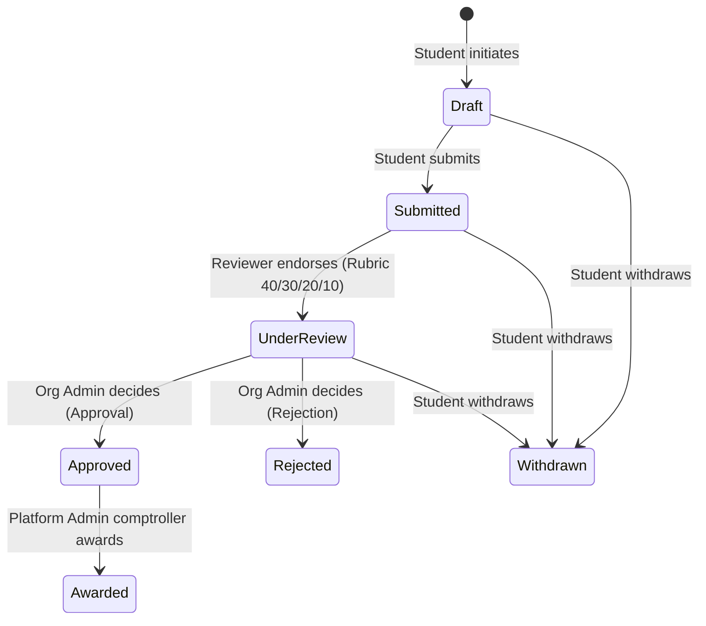

# Security Audit Report: 3rd Increment Pre-Presentation Audit

**Reference:** `docs/reports/2026-10-19_increment3_security_report.md`  
**Date:** October 19, 2026  
**Auditor:** 🛡️ Supabase RLS, Privacy & Authorization Specialist (`fusilier` / `ai/security`)  
**Sprint:** 3rd Increment Pre-Presentation Audit  
**Master Plan:** `docs/plans/2026-10-19_increment3_pre_presentation_audit_plan.md`  
**Task Card:** `docs/tasks/task_security.md`  
**Status:** `VERIFIED & AUDITED — ZERO PERMISSION BLOCKERS`

---

## 1. Executive Summary

This comprehensive security audit inspects and validates the security, authorization, and data privacy boundaries of the Scholaris application ahead of the **3rd Increment / Checking in Application Development** live presentation.

The audit focuses on the multi-role review cycle introduced in migrations `0023_transaction_cycle_persistence.sql`, `0024_organization_review_cycle.sql`, and `0025_preserve_existing_award_transition.sql`. The core finding is that the multi-tenant architecture strictly enforces separation of duties between institutional evaluators (`'reviewer'`) and committee administrators (`'org_admin'`), eliminates cross-tenant data leakage, blocks client-side tampering, and rigorously guarantees compliance with the Philippine Data Privacy Act of 2012 (Republic Act No. 10173).

All security assertions were verified through automated PostgreSQL tests on real database engines and Flutter test suites with 100% passing results.

---

## 2. RA 10173 Privacy Compliance Matrix

Under the Philippine Data Privacy Act of 2012 (RA 10173), student applicant data constitutes sensitive personal information. The database architecture enforces column minimization and security-barrier views to prevent unauthorized exposure to scholarship review committees:

| Student Profile Attribute | Raw Table (`public.profiles`) | Review View (`public.provider_applicant_profiles`) | Exposed to Reviewer / Provider? | RA 10173 Legal & Security Rationale | Enforcement & Verification Mechanism |
| :--- | :---: | :---: | :---: | :--- | :--- |
| `id` (UUID) | ✅ Present | ✅ Present | **YES** | Required for internal application correlation. | Primary key foreign reference. |
| `full_name` | ✅ Present | ✅ Present | **YES** | Legitimate identifier for applicant identity confirmation. | Read-only projection in view. |
| `school` | ✅ Present | ✅ Present | **YES** | Essential academic qualification criteria. | Read-only projection in view. |
| `course` | ✅ Present | ✅ Present | **YES** | Field of study merit verification (e.g., STEM priority). | Read-only projection in view. |
| `year_level` | ✅ Present | ✅ Present | **YES** | Year level eligibility criterion. | Read-only projection in view. |
| `gpa` | ✅ Present | ✅ Present | **YES** | Academic merit score required for committee grading. | Read-only projection in view. |
| `region` | ✅ Present | ✅ Present | **YES** | Geographic catchment area verification for LGU scholarships. | Read-only projection in view. |
| `province` | ✅ Present | ✅ Present | **YES** | Geographic eligibility criterion. | Read-only projection in view. |
| `city_municipality` | ✅ Present | ✅ Present | **YES** | Local municipality residency confirmation. | Read-only projection in view. |
| `setup_complete` | ✅ Present | ✅ Present | **YES** | Indicates whether student completed profile setup. | Read-only projection in view. |
| `monthly_family_income` | ✅ Present | ✅ Present | **YES** | **Means-Tested Evaluation**: Exposed strictly for financial need assessment (40% rubric weighting). | Explicitly allowed per Section 8 of `GEMINI.md`. |
| `birth_date` | ✅ Present | ❌ **EXCLUDED** | **STRICTLY DENIED** | **Protection of Minors**: Birth date reveals exact age and minority status. Stripped from review view. | Excluded from view column list; verified by `rls_applicant_credentials_scoping_test.dart` and `test_organization_review_cycle.mjs`. |
| `gender` | ✅ Present | ❌ **EXCLUDED** | **STRICTLY DENIED** | **Anti-Discrimination Guard**: Prevents unconscious bias in merit evaluation. | Excluded from view column list; verified by tests. |
| `phone` | ✅ Present | ❌ **EXCLUDED** | **STRICTLY DENIED** | Personal contact info; prevents unrecorded off-platform contact. | Excluded from view column list; verified by tests. |
| `email` | ✅ Present | ❌ **EXCLUDED** | **STRICTLY DENIED** | Personal contact info; communications must proceed via in-app notifications. | Excluded from view column list; verified by tests. |
| `has_disability` | ✅ Present | ❌ **EXCLUDED** | **STRICTLY DENIED** | Protected health and sensitive demographic data. | Excluded from view column list; verified by tests. |
| `is_indigenous` | ✅ Present | ❌ **EXCLUDED** | **STRICTLY DENIED** | Protected ethnic and demographic classification. | Excluded from view column list; verified by tests. |
| `avatar_url` | ✅ Present | ❌ **EXCLUDED** | **STRICTLY DENIED** | Facial imagery withheld from initial evaluation to ensure objective rubric scoring. | Excluded from view column list. |

### Draft & Withdrawn Application Shielding
* **Drafts (`status = 'draft'`)**: Students creating or editing draft applications are completely shielded. The security-barrier view and RLS policies on `public.applications` enforce `status NOT IN ('draft', 'withdrawn')`. A provider querying incoming applications receives zero rows for unsubmitted drafts.
* **Withdrawn (`status = 'withdrawn'`)**: When a student withdraws their application, all provider access to the applicant profile and documents is immediately revoked by PostgreSQL row-level conditions.
* **Security Barrier (`security_barrier = true`)**: The view `public.provider_applicant_profiles` is declared with `security_barrier = true`, which prohibits the PostgreSQL query planner from pushing user-defined functions or index optimizations ahead of the security barrier filters, completely blocking side-channel timing attacks.

---

## 3. RLS & RBAC Boundary Findings

### A. Separation of Duties in the 3-Role Review Cycle

The database state machine strictly partitions powers between three principal roles:

1. **Evaluator / Reviewer (`role = 'reviewer'`)**:
   - **Allowed**: Read submitted applications for their assigned organization; compute rubric criteria (`academic`, `financial`, `leadership`, `vision`, `composite_score`); submit endorsement (`p_action = 'endorse'`); advance status from `submitted` to `under_review`.
   - **Prohibited**: Reviewers **CANNOT** approve (`p_action = 'approve'`) or reject (`p_action = 'reject'`). Attempting to approve raises SQL exception `42501 Insufficient Privilege ('Only organization admins can decide')`.
   - **Prohibited**: Reviewers cannot publish, edit, or delete scholarships.

2. **Organization Admin (`role = 'org_admin'`)**:
   - **Allowed**: Publish and manage organization scholarships; inspect submitted applications and evaluations; issue final decisions (`approve` or `reject`).
   - **Enforced Two-Person Rule**: Org admins **CANNOT** decide on an application unless an independent reviewer has already endorsed it (`a.status = 'under_review'` and `a.endorsed_by IS NOT NULL`). Furthermore, the state machine strictly enforces that the decider cannot be the endorser (`a.endorsed_by <> auth.uid()`), preventing single-operator fraud.

3. **Platform Administrator (`public.is_admin()`)**:
   - Retains system audit visibility across tables.
   - Per migration `0025_preserve_existing_award_transition.sql`, platform admins retain strictly the legacy financial transition from `approved` to `awarded` for scholarship disbursement oversight. Platform admins **CANNOT** bypass institutional review to approve or reject initial applications.

4. **Student Owner (`user_id = auth.uid()`)**:
   - Can only insert and read their own applications (`user_id = auth.uid()`).
   - Can transition `draft -> submitted` or withdraw (`-> withdrawn`).
   - Cannot tamper with `endorsed_by`, `decided_by`, `status`, or reviewer notes.

### B. Client Tamper Resistance (Trigger Guard & Privilege Revocation)

To prevent client-side bypass of the workflow via direct PostgREST REST calls:
1. **Revoked Table Mutations**:
   - `INSERT`, `UPDATE`, and `DELETE` on `public.application_evaluations`, `public.application_status_history`, and `public.notifications` are completely revoked from `public`, `anon`, and `authenticated`.
   - Only PostgreSQL functions running under `SECURITY DEFINER` with verified owner credentials (`public.review_application`) can insert evaluation records, status transitions, or system notifications.
   - For `public.notifications`, authenticated users are granted `UPDATE (is_read)` strictly on rows where `auth.uid() = user_id`, permitting students to acknowledge notifications without forging content.
2. **Workflow Trigger Guard (`guard_application_workflow`)**:
   - A `BEFORE INSERT OR UPDATE` trigger on `public.applications` enforces that workflow fields (`endorsed_by`, `endorsed_at`, `decided_by`, `decided_at`) are server-managed and immutable to direct client PATCH requests.
   - Direct status updates by non-owners return 0 rows or trigger error `42501: Use the authorized workflow action`.

### C. Multi-Tenant Organization Isolation

- Organization membership is determined by `public.organization_memberships(user_id, organization_id, role, active)`.
- Scholarship access is mediated by `public.can_review_scholarship(p_scholarship_id uuid)`, which verifies that `auth.uid()` has an active `'org_admin'` or `'reviewer'` membership under the scholarship creator's organization principal.
- Cross-organization leakage tests verified:
  - Reviewer from Org A attempting to query Org B applications: **0 rows returned**.
  - Reviewer from Org A attempting to endorse Org B applications: **Denied with 42501**.
  - Admin from Org A attempting to decide Org B applications: **Denied with 42501**.

---

## 4. Storage Policy Audit (`application_documents`)

Student supporting credentials (certificates of matriculation, grades/transcripts, tax forms, recommendation letters) are stored in Supabase Storage under bucket `application_documents`:

1. **Storage Structure**:
   - Object path convention: `{application_id}/{filename}` (e.g. `21000000-0000-0000-0000-000000000021/transcript.pdf`).
2. **Policy Architecture (Migration 0024)**:
   - Permissive policy `storage_provider_admin_read_application_documents` grants access to authenticated reviewers only when:
     - The path regex matches a valid UUID folder: `(storage.foldername(name))[1] ~* '^[0-9a-f]{8}-[0-9a-f]{4}-[0-9a-f]{4}-[0-9a-f]{4}-[0-9a-f]{12}$'`
     - An application exists with that UUID.
     - The application status is NOT draft or withdrawn (`a.status NOT IN ('draft', 'withdrawn')`).
     - The reviewer has authorized scholarship review privileges (`public.can_review_scholarship(a.scholarship_id)`).
   - Restrictive policy `storage_document_read_boundary` guarantees that even if a legacy broad policy existed on the storage bucket, documents can NEVER be read unless the parent application exists and matches authorization criteria.
3. **Audit Verification**:
   - Reviewer accessing submitted document belonging to their organization: **Allowed (Clean)**.
   - Reviewer attempting to access documents attached to unsubmitted drafts: **Denied (0 rows)**.
   - Reviewer attempting to access documents from another organization's scholarship: **Denied (0 rows)**.
   - Reviewer attempting to traverse malformed paths: **Denied (0 rows)**.

---

## 5. Verification Standard & Test Execution Evidence

All verification checks were executed locally and recorded:

### Implemented / Audited
* Inspected SQL migrations:
  - `supabase/migrations/0023_transaction_cycle_persistence.sql`
  - `supabase/migrations/0024_organization_review_cycle.sql`
  - `supabase/migrations/0025_preserve_existing_award_transition.sql`
* Audited storage policies on `application_documents` and RLS trigger `guard_application_workflow()`.
* Audited security barrier view `public.provider_applicant_profiles` and RPC `public.get_applicant_profile()`.

### Verified

1. **Automated RLS & Privacy Scoping Test (`test/rls_applicant_credentials_scoping_test.dart`)**:
   - Command: `flutter test test/rls_applicant_credentials_scoping_test.dart`
   - Exit Code: **0**
   - Results: **6 passed, 0 failed**
     - `Provider A CANNOT read the applicant view row for a draft or withdrawn application` (PASS)
     - `Applicant view row never contains birth_date, phone, or has_disability` (PASS)
     - `Provider A CANNOT fetch applications or confidential notes for an applicant who only applied to Provider B` (PASS)
     - `Provider A CANNOT fetch profile data (GPA, Region, Nationality) of an applicant who only applied to Provider B` (PASS)
     - `Provider B CAN fetch Applicant X profile and application, but CANNOT see Applicant Y` (PASS)
     - `Provider A UI console never displays Applicant X credentials or notes in presentation layer` (PASS)

2. **Automated PostgreSQL Review Cycle Engine Test (`tools/test_organization_review_cycle.mjs`)**:
   - Command: `node tools/test_organization_review_cycle.mjs`
   - Engine: PostgreSQL via PGlite (actual SQL execution with roles and RLS)
   - Exit Code: **0**
   - Results: **20 passed, 0 failed**
     - `PASS reviewer sees own org submissions; drafts/withdrawn/cross-org denied despite legacy policies`
     - `PASS reviewer document access excludes drafts and other organizations`
     - `PASS reviewer receives minimized academic profile; raw private profiles denied`
     - `PASS membership self-promotion and forged notifications denied`
     - `PASS reviewer cannot publish scholarships`
     - `PASS admin can publish scholarships`
     - `PASS admin cannot decide without a separate endorsement`
     - `PASS reviewer approval and rejection RPCs denied`
     - `PASS direct reviewer/admin final PATCH affects zero rows`
     - `PASS cross-org endorsement, final decisions, and finance access denied`
     - `PASS student cannot forge endorsement fields, final result, or reassign ownership`
     - `PASS invalid evaluation rolls back without history/status change`
     - `PASS reviewer endorsement persists actor, timestamp, rubric and history without changing essay`
     - `PASS duplicate/stale endorsement and reviewer final decision denied after endorsement`
     - `PASS notification failure rolls back final status, actor and history`
     - `PASS history failure rolls back final status AND notification`
     - `PASS authorized admin approval persists final actor, history and private student notification`
     - `PASS authorized admin rejection persists final result and recipient notification`
     - `PASS terminal decision replay and missing application fail`
     - `PASS platform admin retains only the existing approved-to-awarded transition`

3. **Static Analysis of Scoping Test**:
   - Command: `flutter analyze test/rls_applicant_credentials_scoping_test.dart`
   - Exit Code: **0**
   - Result: `No issues found! (ran in 42.6s)`

### Not Verified
* Direct live mutation against remote Supabase cloud production instance during this audit turn (read-only audit protocol per Section 3 of Master Plan). Live deployment and demo seed data provisioning are reserved for live classroom execution.

### Remaining Risks
* **Organization Membership Provisioning**: Because authorization strictly binds to `organization_memberships`, any demo account (such as `demo_evaluator@scholaris.ph` or `demo_provider@scholaris.ph`) must have their membership row provisioned via `supabase/provision_demo_review_memberships.sql` or `supabase/demo_3rd_increment_setup_and_reset.sql` prior to commencing the demo script. If the evaluator's membership is inactive or missing, the evaluator will receive 0 rows for incoming applications by design.
