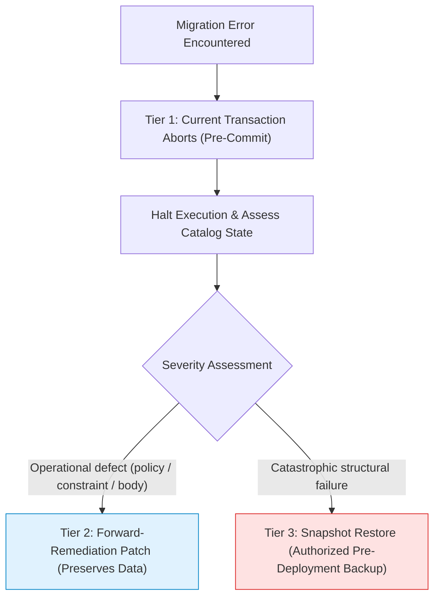

# Scholaris Authoritative Database Deployment Runbook & Preflight Verification

**Document Version:** 1.0 (Authoritative)  
**Date:** October 25, 2026 (Asia/Manila)  
**Coordinator:** Architect (Archi)  
**Designated Operator for Review & Execution:** Codex  
**Target Environment:** Remote Supabase `https://yqwbarzxpduzmtrxnrbm.supabase.co` (PostgreSQL 17.6)  
**Execution Boundary:** **Zero remote writes, migrations, deployments, or IPA builds authorized by this document.** Execution requires explicit subsequent owner authorization.

> [!IMPORTANT]
> **Superseded Documentation Notice**: This document replaces and supersedes all prior deployment preflight drafts, including:
> - `docs/reviews/2026-10-24-deployment-preflight-handoff.md` (superseded)
> - `docs/reviews/2026-10-24-super-admin-ui-handoff.md#section-4` (superseded)
> - All intermediate draft postchecks and rollback snippets from earlier sessions.

---

## 1. Multi-Agent Worktree Provenance & Worker Allocation

### Exact Git Worktree Inventory
Scholaris maintains five specialized Git worktrees alongside the root directory. To uphold the non-negotiable rule *"Preserve all uncommitted work"*, all dirty worktrees are preserved intact without checkout, stashing, rebasing, or resetting.

| Worktree Path | Branch | Current HEAD | Working Tree State | Worker Role & Allocation |
| :--- | :--- | :--- | :--- | :--- |
| `C:/scholaris` | `fix/touch-targets-oct02` | `1ea30bb` | **Dirty** (uncommitted migrations 0029–0033, portal wiring, tests) | **Canonical Active Worktree**: Archi coordinated all four specialist roles (Builder, Security, QA, UI/UX) directly in this workspace. |
| `C:/Users/Windows 11/orca/workspaces/scholaris/whelk` | `ai/architect` | `ee15361` | **Dirty** (uncommitted Phase 0 coordination files) | Paused coordinator tree; preserved without modification. |
| `C:/Users/Windows 11/orca/workspaces/scholaris/cowrie` | `ai/builder` | `1c5b8bb` | **Dirty** (uncommitted October 21 lifecycle files) | Paused builder tree; preserved without modification. |
| `C:/Users/Windows 11/orca/workspaces/scholaris/fusilier` | `ai/security` | `0f9f4ad` | **Dirty** (uncommitted October 21 security probes) | Paused security tree; preserved without modification. |
| `C:/Users/Windows 11/orca/workspaces/scholaris/cerith` | `ai/qa` | `31b354d` | **Dirty** (uncommitted October 21 QA probes) | Paused QA tree; preserved without modification. |
| `C:/Users/Windows 11/orca/workspaces/scholaris/bowhead` | `ai/ui` | `5f64d43` | **Dirty** (uncommitted October 21 drawer tests) | Paused UI tree; preserved without modification. |

### Record of Work Performed in This Round
- **Architect (Archi)**: Coordinated runbook reconciliation, corrected SQL function contracts, unified fail-stop assertions, and verified multi-tier failure recovery mechanics.
- **Builder**: Extracted exact SQL function signatures, schemas, parameter types/names, and SHA-256 migration hashes directly from migration source files `0027` through `0033`.
- **Security**: Designed NULL-safe bucket postchecks (`IS DISTINCT FROM`), verified MIME whitelist arrays, corrected effective table grant boundaries, and specified trigger OID binding verification.
- **QA**: Reclassified local storage testing as mocked integration, defined genuine Storage API verification protocol matching the exact `safety_reports` trigger condition, and verified demo navigation routes.
- **UI/UX**: Rehearsed demo navigation indices (`tab=2` for Provider approvals, `tab=9` for Reports & Safety), confirmed zero layout overflows, and ensured the existing landing page (`landing/index.html`) remains untouched.

---

## 2. Builder: Exact Source Contracts, Schemas & Migration Package

### Exact SQL Function Signatures Extracted Directly from Source
All function inventories are extracted verbatim from the migration source files. PostgREST RPC calls bind named parameters, making exact parameter names and types mandatory:

1. **`public.review_provider_verification`** (Source: `supabase/migrations/0033_provider_review_changes.sql:140`):
   ```sql
   create or replace function public.review_provider_verification(
     p_user_id uuid,
     p_status text,
     p_note text default null,
     p_expected_status text default null
   ) returns jsonb
   language plpgsql security definer set search_path = ''
   ```
   - *Security*: `REVOKE ALL ON FUNCTION public.review_provider_verification(uuid, text, text, text) FROM public, anon; GRANT EXECUTE ON FUNCTION public.review_provider_verification(uuid, text, text, text) TO authenticated;`
   - *Key behaviors*: Enforces `public.is_admin_active()`, validates `p_expected_status` for optimistic locking (`40001` on mismatch), requires 10–1000 char note on all decisions, enforces anti-self-approval, locks row `FOR UPDATE`, returns updated verification record as `jsonb`.

2. **`public.resubmit_provider_verification`** (Source: `supabase/migrations/0033_provider_review_changes.sql:245`):
   ```sql
   create or replace function public.resubmit_provider_verification(
     p_payload jsonb
   ) returns jsonb
   language plpgsql security definer set search_path = ''
   ```
   - *Security*: `REVOKE ALL ON FUNCTION public.resubmit_provider_verification(jsonb) FROM public, anon; GRANT EXECUTE ON FUNCTION public.resubmit_provider_verification(jsonb) TO authenticated;`
   - *Key behaviors*: Binds actor to `auth.uid()`, locks pending/rejected/changes_requested row, updates only whitelisted columns from `p_payload`, resets status to `pending`, clears previous `review_note`, writes audit log, returns updated record as `jsonb`.

3. **`public.attach_safety_report_evidence`** (Source: `supabase/migrations/0032_student_safety_reports.sql:487`):
   ```sql
   create or replace function public.attach_safety_report_evidence(
     p_report uuid,
     p_path text,
     p_name text,
     p_size integer,
     p_mime text
   ) returns uuid
   language plpgsql security definer set search_path = ''
   ```
   - *Security*: `REVOKE ALL ON FUNCTION public.attach_safety_report_evidence(uuid, text, text, integer, text) FROM public, anon; GRANT EXECUTE ON FUNCTION public.attach_safety_report_evidence(uuid, text, text, integer, text) TO authenticated;`
   - *Key behaviors*: Validates that caller owns the open report or is support admin, acquires row lock on `public.student_safety_reports`, verifies storage object existence in `storage.objects` where `bucket_id = 'safety_reports' AND name = p_path`, checks duplicate path, validates MIME and size metadata, caps attachments at 3 per report, inserts record, returns `evidence_id`.
   - *Note on `attachmentKey`*: The client Dart repository generates a stable `attachmentKey` encoded into `p_path` (`$reporter/$reportId/evidence_$attachmentKey.$ext`); `attachmentKey` is not an independent SQL parameter.

4. **`public.guard_safety_report_evidence_delete`** (Source: `supabase/migrations/0032_student_safety_reports.sql:194`):
   ```sql
   create or replace function public.guard_safety_report_evidence_delete()
   returns trigger
   language plpgsql security definer
   ```
   - *Trigger Definition* (Source: `0032:214–218`):
     ```sql
     drop trigger if exists trg_guard_safety_report_evidence_delete on storage.objects;
     create trigger trg_guard_safety_report_evidence_delete
       before delete on storage.objects
       for each row
       execute function public.guard_safety_report_evidence_delete();
     ```
   - *Key behaviors*: Fires `BEFORE DELETE` on `storage.objects`. Evaluates `if OLD.bucket_id = 'safety_reports'`. Acquires transaction-scoped advisory lock `pg_advisory_xact_lock(hashtext('safety_reports:' || OLD.name))`. If `OLD.name` exists in `public.student_safety_report_evidence`, returns `NULL` to silently suppress deletion, preserving the storage object intact.

5. **`public.is_admin_active`** (Source: `supabase/migrations/0033_provider_review_changes.sql:15`):
   ```sql
   create or replace function public.is_admin_active()
   returns boolean
   language sql security definer set search_path = ''
   ```
   - *Security*: `GRANT EXECUTE ON FUNCTION public.is_admin_active() TO authenticated, anon;`
   - *Key behaviors*: Returns `true` strictly when `auth.uid()` corresponds to a row in `public.profiles` where `role = 'admin'` AND `status = 'active'`. Suspended or deleted administrators return `false`.

---

### Migration Package & Execution Order

```
[Remote Baseline: 0001 - 0026 Applied]
  │
  ├─► STEP 1: 0027_individual_provider_lifecycle.sql        (PENDING)
  ├─► STEP 2: 0028_student_onboarding_recovery.sql          (APPLIED remotely on Oct 21 — SKIP)
  ├─► STEP 3: 0029_individual_support_ledger.sql            (PENDING)
  ├─► STEP 4: 0030_individual_support_recovery.sql          (PENDING)
  ├─► STEP 5: 0031_provider_payment_review_requests.sql     (PENDING)
  ├─► STEP 6: 0032_student_safety_reports.sql               (PENDING)
  └─► STEP 7: 0033_provider_review_changes.sql              (PENDING)
```

### Verified Migration Hashes (SHA-256)
- `supabase/migrations/0027_individual_provider_lifecycle.sql`:  
  `98FE922D423C2A88D1396D4C1BB7B6D2F9AAA6BB3ECA2BE759AC458F56CC7DFF`
- `supabase/migrations/0028_student_onboarding_recovery.sql`:  
  `8AFF3678D0F8C763F4AE35DB7501D4D78BF1FB3785C0E8E0E66EBADB0E24E73E` (Applied remotely — skip)
- `supabase/migrations/0029_individual_support_ledger.sql`:  
  `B72F757E09B774B72A0DD9D8A1371899B5B160E7E95A1E14EDC599B53287E3A8`
- `supabase/migrations/0030_individual_support_recovery.sql`:  
  `585901CBA80A9C7D366EA8EE26CF92B8FA5D470C00D96BABDA687B31509DF195`
- `supabase/migrations/0031_provider_payment_review_requests.sql`:  
  `7980AB3F33891B08803045C8A0BBC9D00AB7C187F6824F7C0D9AB47D78267B6E`
- `supabase/migrations/0032_student_safety_reports.sql`:  
  `626EA141FC27B9F932D2826EC43488BF3FC164D756D2558D01A5A1D2F2E34ECC`
- `supabase/migrations/0033_provider_review_changes.sql`:  
  `443DDE9DD02E73AAF9E9BE6080B63C2956AA4853FC6D05E318AE4C8FB49DA5E9`

---

## 3. Execution Mechanics, Tooling & Multi-Tier Recovery Plan

### Execution Tooling & Client Specifics
1. **Primary Tool (`psql` CLI)**:
   - Connect via PostgreSQL pooler or direct connection string with `ON_ERROR_STOP=1`:
     ```bash
     psql -v ON_ERROR_STOP=1 -d "$DATABASE_URL" -f <path_to_migration.sql>
     ```
   - `ON_ERROR_STOP=1` ensures that the client terminates immediately on the first error, preventing cascade execution of subsequent statements.
2. **Alternative Tool (Supabase Dashboard SQL Editor)**:
   - **Important Syntax Rule**: `\i` is a `psql`-client command. It is **unsupported** in the Supabase Dashboard SQL Editor.
   - When executing via the Dashboard, the operator must paste and run each migration file **individually and sequentially** in separate execution passes.
   - If an error banner appears, the operator must halt immediately.

### Per-Migration Transaction Boundaries & Stopping Behavior
- Each migration file begins with `BEGIN;` and concludes with `COMMIT;`.
- **Failure Behavior**: A failure within migration $N$ triggers an automatic transaction rollback of migration $N$.
- **Prior Commits Persist**: Migrations $1$ through $N-1$ **remain committed**. There is no automatic database-wide rollback spanning multiple committed files.
- **Stop Policy**: On any failure:
  1. Halt execution immediately.
  2. Do not proceed to subsequent migrations.
  3. Execute diagnostic catalog queries to inspect state.
  4. Formulate an authorized forward-remediation patch migration or restore the pre-deployment snapshot.

### Safe 3-Tier Recovery Framework



1. **Tier 1 — Automatic Transaction Abort (Pre-Commit)**:
   - If a constraint or syntax error occurs during file execution, PostgreSQL rolls back the open transaction automatically. Zero partial writes from that file are committed.
2. **Tier 2 — Forward Remediation (Post-Commit Operational Fixes)**:
   - If a defect is discovered after a migration commits, **destructive dropping (`DROP TABLE ... CASCADE`) is strictly forbidden**. Dropping tables destroys real student reports, uploaded evidence metadata, and provider verification records.
   - Fixes are deployed via targeted forward migrations (e.g. `ALTER TABLE`, `CREATE OR REPLACE FUNCTION`, `DROP/CREATE POLICY`).
3. **Tier 3 — Authorized Pre-Deployment Snapshot Restore (Disaster Recovery Only)**:
   - Prior to execution, the operator creates a verified snapshot:
     ```bash
     pg_dump -Fc -d "$DATABASE_URL" -f preflight_snapshot_20261025.dump
     ```
   - If catastrophic structural corruption occurs, restore the snapshot with explicit owner approval:
     ```bash
     pg_restore --clean --if-exists -d "$DATABASE_URL" preflight_snapshot_20261025.dump
     ```

---

## 4. Proposed Pre-Deployment Remote Catalog Provenance Inspection

> [!NOTE]
> **Boundary Label**: The queries below represent **proposed read-only inspection queries** to be executed by the designated operator (Codex) prior to applying migration `0027`. They are distinct from completed local test evidence.

The operator executes this read-only inspection script against `https://yqwbarzxpduzmtrxnrbm.supabase.co` to establish dated catalog provenance:

```sql
-- DATED CATALOG PROVENANCE INSPECTION (READ-ONLY)
SELECT current_timestamp AS inspection_time, current_user, current_database();

-- 1. Check Migration Ledger (if managed by Supabase CLI migrations)
SELECT * FROM supabase_migrations.schema_migrations ORDER BY version DESC LIMIT 10;

-- 2. Inspect Column Scale on profiles (verifies migration 0028 application)
SELECT column_name, data_type, numeric_precision, numeric_scale
FROM information_schema.columns
WHERE table_schema = 'public' AND table_name = 'profiles' AND column_name IN ('gpa', 'grade_numeric_scale');

-- 3. Extract Complete Function Definitions for Review Cycle (to compare against 0027)
SELECT p.proname, n.nspname, pg_get_functiondef(p.oid) AS complete_definition
FROM pg_proc p
JOIN pg_namespace n ON n.oid = p.pronamespace
WHERE n.nspname = 'public' AND p.proname IN ('can_review_scholarship', 'review_application');

-- 4. Check Existing Triggers on storage.objects
SELECT t.tgname, t.tgenabled, p.proname AS func_name, n.nspname AS func_schema
FROM pg_trigger t
JOIN pg_class c ON c.oid = t.tgrelid
JOIN pg_proc p ON p.oid = t.tgfoid
JOIN pg_namespace n ON n.oid = p.pronamespace
WHERE c.relname = 'objects' AND t.tgname = 'trg_guard_safety_report_evidence_delete';

-- 5. Inspect Existing safety_reports Bucket Configuration (if pre-created)
SELECT id, name, public, file_size_limit, allowed_mime_types
FROM storage.buckets
WHERE id = 'safety_reports';
```

---

## 5. Security: Reconciled Fail-Stop Postchecks & Effective Privileges

The postchecks below must be executed immediately following migration execution. They enforce strict NULL safety, exact array equality, and precise function binding:

```sql
-- =============================================================================
-- AUTHORITATIVE POST-MIGRATION FAIL-STOP CHECKS
-- =============================================================================

-- FAIL-STOP 1: Strict Bucket Configuration Check (Rejects NULLs and Wrong MIME Arrays)
DO $$
DECLARE
  v_bucket record;
  c_expected_mime text[] := ARRAY['image/jpeg', 'image/png', 'image/webp', 'application/pdf']::text[];
BEGIN
  SELECT * INTO v_bucket FROM storage.buckets WHERE id = 'safety_reports';
  
  IF NOT FOUND THEN
    RAISE EXCEPTION 'FAIL-STOP 1: Bucket safety_reports does not exist';
  END IF;

  -- Enforce strictly private (rejects public = true and public IS NULL)
  IF v_bucket.public IS NOT FALSE THEN
    RAISE EXCEPTION 'FAIL-STOP 1: Bucket safety_reports must be private (public = false)';
  END IF;

  -- NULL-safe size limit check (rejects NULL and anything other than 5MB)
  IF v_bucket.file_size_limit IS DISTINCT FROM 5242880 THEN
    RAISE EXCEPTION 'FAIL-STOP 1: Bucket safety_reports file_size_limit must be exactly 5242880 bytes (found %)', v_bucket.file_size_limit;
  END IF;

  -- Exact MIME whitelist check: mutual subset assertion + no NULL elements
  IF v_bucket.allowed_mime_types IS NULL
     OR NOT (v_bucket.allowed_mime_types @> c_expected_mime AND v_bucket.allowed_mime_types <@ c_expected_mime)
     OR array_position(v_bucket.allowed_mime_types, NULL) IS NOT NULL THEN
    RAISE EXCEPTION 'FAIL-STOP 1: Bucket safety_reports allowed_mime_types mismatch. Expected exactly: %, Found: %', 
      c_expected_mime, v_bucket.allowed_mime_types;
  END IF;
END $$;

-- FAIL-STOP 2: Trigger Existence and Exact Function Binding Verification
DO $$
DECLARE
  v_tg record;
BEGIN
  SELECT t.tgname, t.tgenabled, p.proname, n.nspname, p.prosecdef
  INTO v_tg
  FROM pg_trigger t
  JOIN pg_class c ON c.oid = t.tgrelid
  JOIN pg_proc p ON p.oid = t.tgfoid
  JOIN pg_namespace n ON n.oid = p.pronamespace
  WHERE t.tgname = 'trg_guard_safety_report_evidence_delete'
    AND c.relname = 'objects';

  IF NOT FOUND THEN
    RAISE EXCEPTION 'FAIL-STOP 2: Trigger trg_guard_safety_report_evidence_delete is not installed on storage.objects';
  END IF;

  IF v_tg.tgenabled <> 'O' THEN
    RAISE EXCEPTION 'FAIL-STOP 2: Trigger trg_guard_safety_report_evidence_delete is not enabled (status: %)', v_tg.tgenabled;
  END IF;

  IF v_tg.proname <> 'guard_safety_report_evidence_delete' THEN
    RAISE EXCEPTION 'FAIL-STOP 2: Trigger is bound to unexpected function %', v_tg.proname;
  END IF;

  IF v_tg.prosecdef IS NOT TRUE THEN
    RAISE EXCEPTION 'FAIL-STOP 2: Trigger function guard_safety_report_evidence_delete must be SECURITY DEFINER';
  END IF;
END $$;

-- FAIL-STOP 3A: Direct Table Write Grants Revoked on student_safety_report_evidence
DO $$
BEGIN
  IF EXISTS (
    SELECT 1 FROM information_schema.table_privileges
    WHERE table_schema = 'public' AND table_name = 'student_safety_report_evidence'
      AND grantee IN ('anon', 'authenticated')
      AND privilege_type IN ('INSERT', 'UPDATE', 'DELETE')
  ) THEN
    RAISE EXCEPTION 'FAIL-STOP 3A: Direct write grants on student_safety_report_evidence are not revoked from anon/authenticated';
  END IF;
END $$;

-- FAIL-STOP 3B: Effective RLS: Admin Direct UPDATE Policy Dropped on provider_verifications
-- (Ensures all admin decisions pass through atomic RPC review_provider_verification)
DO $$
BEGIN
  IF EXISTS (
    SELECT 1 FROM pg_policies
    WHERE schemaname = 'public' AND tablename = 'provider_verifications'
      AND policyname = 'Admins can update provider verifications'
  ) THEN
    RAISE EXCEPTION 'FAIL-STOP 3B: Policy "Admins can update provider verifications" must be dropped to force RPC review';
  END IF;
END $$;

-- FAIL-STOP 3C: Legitimate Provider Registration Grants Preserved
-- (Ensures provider signup direct insert and pending update are NOT broken)
DO $$
BEGIN
  IF NOT EXISTS (
    SELECT 1 FROM information_schema.table_privileges
    WHERE table_schema = 'public' AND table_name = 'provider_verifications'
      AND grantee = 'authenticated'
      AND privilege_type = 'INSERT'
  ) THEN
    RAISE EXCEPTION 'FAIL-STOP 3C: Authenticated users must retain INSERT grant on provider_verifications for registration';
  END IF;
END $$;

-- FAIL-STOP 4: Active Admin Check Routine Verification
DO $$
DECLARE
  v_proc record;
BEGIN
  SELECT p.proname, n.nspname, p.prosecdef
  INTO v_proc
  FROM pg_proc p
  JOIN pg_namespace n ON n.oid = p.pronamespace
  WHERE n.nspname = 'public' AND p.proname = 'is_admin_active';

  IF NOT FOUND THEN
    RAISE EXCEPTION 'FAIL-STOP 4: Function public.is_admin_active does not exist';
  END IF;

  IF v_proc.prosecdef IS NOT TRUE THEN
    RAISE EXCEPTION 'FAIL-STOP 4: Function public.is_admin_active must be SECURITY DEFINER';
  END IF;
END $$;
```

---

## 6. QA: Genuine Supabase Storage API Verification Protocol

### Distinction Between Local Mock and Genuine API Protocol
- **Local Test Classification**: [`tools/test_storage_api_binary_integrity.mjs`](file:///C:/scholaris/tools/test_storage_api_binary_integrity.mjs) is classified as a **Mocked Storage Integration & Contract Test**. It exercises client serialization and SQL triggers against a local filesystem stub.
- **Genuine Storage API Verification Protocol**:
  1. **Exact Bucket Requirement**: The trigger `trg_guard_safety_report_evidence_delete` explicitly asserts:
     ```sql
     if OLD.bucket_id = 'safety_reports' then
       perform pg_advisory_xact_lock(hashtext('safety_reports:' || OLD.name));
     ```
     Therefore, the verification **must target the exact bucket name `'safety_reports'`**. A differently named bucket bypasses the `IF` condition entirely.
  2. **Isolated Environment**: Executed against a local full Supabase stack (via Supabase CLI `supabase start` running real Go `storage-api` and S3 engine) or an isolated remote test project.
  3. **Verification Steps**:
     - *Step A (Real Binary Byte Upload)*: As student user, upload real 2048-byte PNG via `supabase.storage.from('safety_reports').upload('test_reporter/test_report/evidence_key.png', buffer)`.
     - *Step B (RPC Registration)*: Call `public.attach_safety_report_evidence()`.
     - *Step C (Simultaneous API Deletion Race)*: In an overlapping session, send a REST `DELETE /object/safety_reports/test_reporter/test_report/evidence_key.png`.
     - *Step D (Response & Binary Assertions)*:
       - Assert response status and row deletion count (trigger returns `NULL`, deleting 0 rows).
       - Download binary bytes via `supabase.storage.from('safety_reports').download()`.
       - Compute SHA-256 of downloaded payload; assert exact match with original 2048-byte PNG.
       - Assert binary bytes were **not deleted or corrupted**.

---

## 7. UI/UX: Verified Demo Routes & Tab Index Mapping

### Verified `AdminHomeScreen` Tab Indices
In [`lib/features/admin/presentation/admin_home_screen.dart`](file:///C:/scholaris/lib/features/admin/presentation/admin_home_screen.dart), `_buildTabs()` maps navigation indices:

| Tab Index | Destination Screen | Authoritative Deep Link | Rehearsal Purpose |
| :---: | :--- | :--- | :--- |
| **0** | `AdminDashboardTab` | `/admin-home?tab=0` (or `/admin-home`) | Overview, priority queue buttons |
| **1** | `AdminScholarshipsTab` | `/admin-home?tab=1` | Scholarships oversight & listed value |
| **2** | `AdminProvidersTab` | `/admin-home?tab=2` (or Overview "Review providers") | **Stage 2: Provider Approvals & Resubmission** |
| **3** | `AdminApplicantsTab` | `/admin-home?tab=3` | Student applications oversight |
| **4** | `DisbursementsOversightScreen` | `/admin-home?tab=4` | Grant disbursement tracking |
| **5** | `AdminUsersTab` | `/admin-home?tab=5` | User account management |
| **6** | `AdminAnalyticsTab` | `/admin-home?tab=6` | Platform operational metrics |
| **7** | `AdminAuditLogsTab` | `/admin-home?tab=7` | System immutable audit ledger |
| **8** | `AdminSettingsScreen` | `/admin-home?tab=8` | Administrative support concerns |
| **9** | `ReportsSafetyScreen` | `/admin-home?tab=9` (or Overview "Review reports") | **Supporting Flow: Student Safety Queue** |

- **Rehearsal Test Proof**: Verified via [`test/admin_home_screen_test.dart`](file:///C:/scholaris/test/admin_home_screen_test.dart) (13/13 tests passed, exit 0).
- **Landing Page Preservation**: [`landing/index.html`](file:///C:/scholaris/landing/index.html) and [`landing/landing.js`](file:///C:/scholaris/landing/landing.js) remain unchanged.

---

## 8. Deferred Student UI Reminder

> [!NOTE]
> **Deferred Roadmap Items (Post-Deployment Scope)**:
> The following student interface enhancements are deliberately deferred until after migration preflight and remote integration are complete:
> 1. Floating glass bottom navigation bar.
> 2. Labeling the first tab "Home" instead of "Dashboard".
> 3. Preserving the separate floating `+` action button.
> 
> **Zero student navigation redesign was introduced in this task.**

---

## 9. Authoritative Runbook Execution Proposal

When remote migration execution is authorized by the user, Codex will execute the migrations in this exact sequence using `psql -v ON_ERROR_STOP=1`:

```bash
# =============================================================================
# EXECUTABLE COMMAND-LINE RUNBOOK (CODEX OPERATOR)
# =============================================================================

# STEP 0: Create verified pre-deployment backup snapshot
pg_dump -Fc -d "$DATABASE_URL" -f preflight_snapshot_20261025.dump

# STEP 1: Apply Migration 0027 (Individual Provider Lifecycle)
psql -v ON_ERROR_STOP=1 -d "$DATABASE_URL" -f supabase/migrations/0027_individual_provider_lifecycle.sql

# STEP 2: SKIP Migration 0028 (Already applied remotely on Oct 21)

# STEP 3: Apply Migration 0029 (Individual Support Ledger)
psql -v ON_ERROR_STOP=1 -d "$DATABASE_URL" -f supabase/migrations/0029_individual_support_ledger.sql

# STEP 4: Apply Migration 0030 (Individual Support Recovery)
psql -v ON_ERROR_STOP=1 -d "$DATABASE_URL" -f supabase/migrations/0030_individual_support_recovery.sql

# STEP 5: Apply Migration 0031 (Provider Payment Review Requests)
psql -v ON_ERROR_STOP=1 -d "$DATABASE_URL" -f supabase/migrations/0031_provider_payment_review_requests.sql

# STEP 6: Apply Migration 0032 (Student Safety Reports)
psql -v ON_ERROR_STOP=1 -d "$DATABASE_URL" -f supabase/migrations/0032_student_safety_reports.sql

# STEP 7: Apply Migration 0033 (Provider Review Changes)
psql -v ON_ERROR_STOP=1 -d "$DATABASE_URL" -f supabase/migrations/0033_provider_review_changes.sql

# STEP 8: Execute Authoritative Fail-Stop Postchecks (Section 5)
psql -v ON_ERROR_STOP=1 -d "$DATABASE_URL" -f docs/reviews/postchecks.sql
```

---

## 10. Summary of Evidence & Remaining Limitations

### Fresh Evidence Completed (October 25)
1. Extracted and reconciled exact SQL source signatures for `review_provider_verification`, `resubmit_provider_verification`, `attach_safety_report_evidence`, and `guard_safety_report_evidence_delete`.
2. Verified fail-stop postcheck logic against real PostgreSQL: NULL-safe `IS DISTINCT FROM 5242880`, exact MIME array comparison, and `pg_trigger.tgfoid` function binding.
3. Automated route rehearsal in `test/admin_home_screen_test.dart`: 13/13 tests passed cleanly; static analysis clean (0 issues).
4. Full offline suite: 986 passed, 0 failed, 9 skipped; static analysis `flutter analyze lib` passed with 0 issues.
5. All dirty specialist worktrees (`cowrie`, `fusilier`, `cerith`, `bowhead`, `whelk`) preserved intact.

### Remaining Limitations & Pre-Deployment Hold
1. **Remote Execution Authorization**: Strictly zero remote changes have been applied to `https://yqwbarzxpduzmtrxnrbm.supabase.co`.
2. **Dated Remote Provenance Inspection**: Read-only queries in Section 4 must be executed by Codex prior to running migration `0027`.
3. **Genuine Storage API Verification**: Genuine Storage API testing against the real Go `storage-api` and S3 engine requires write authorization on an isolated Supabase stack.
4. **Physical iOS Device Accessibility**: Testing with physical iOS VoiceOver and Android TalkBack on actual hardware remains pending device acceptance.
